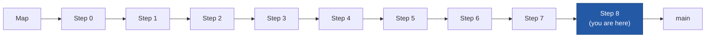
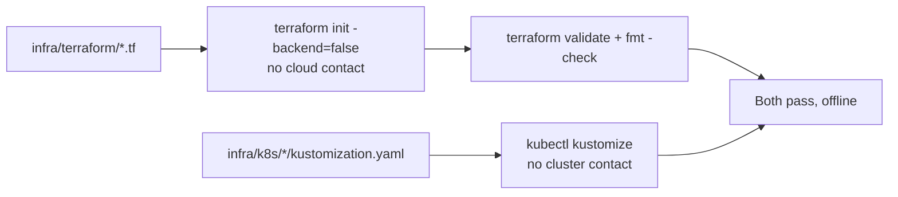

# CrossExam -- Step 8: cloud

Step 8 of 8 in the branch-by-branch build. &larr; [Step 7](https://github.com/mayank953/crossexam-project/tree/build/step-7-see-inside) &middot; [Map](https://github.com/mayank953/crossexam-project/tree/build/map) &middot; [The finished system (main)](https://github.com/mayank953/crossexam-project/tree/main)

## Why this step exists

Every step so far runs on one laptop. This step writes down, as code, what it would take to run the same system on a cluster instead -- and validates that code offline. **Nothing in this step touches Google Cloud.** There is no project ID in `.env`, nothing is applied, and nothing costs money.

## What this step adds

- **`infra/terraform/`** (the exact files from `main`): a GKE cluster, the VPC and NAT it sits in, IAM for the workload (including Workload Identity Federation, so no service-account JSON key ever exists), Secret Manager entries for the Gemini key and the database password, an Artifact Registry repository, and KEDA (so a worker pool can scale on queue depth, not CPU).
- **`infra/k8s/`** (the exact files from `main`): four Kustomize overlays -- `base` (namespace, service accounts, secrets), `app` (api, web, workers, Flower, cron jobs), `migrate` (a one-shot job), `public` (an optional ingress).
- **`.github/workflows/`** (the exact files from `main`): `ci.yml` runs the test suite on every PR; `deploy.yml` builds the image and applies `infra/k8s` to GKE after CI passes, authenticating with Workload Identity Federation.
- **`make validate`**: the one new command this step adds -- `terraform init -backend=false`, `terraform validate`, `terraform fmt -check`, and a local `kubectl kustomize` render of all four overlays. No cloud credentials are used or needed for any of it.

## Where this sits



## What happens inside this step



## Requirements

- **Terraform** and **kubectl** (with the `kustomize` subcommand, bundled since kubectl 1.14) installed locally. Docker is not needed for this step's own validation.
- No Google Cloud project, no `gcloud` login, no billing account. `terraform.tfvars.example` exists only as a template; no `terraform.tfvars` exists in this branch, and `terraform plan`/`apply` are never run.

## Run it

```bash
make validate
```
A real run:
```
cd infra/terraform && terraform init -backend=false -input=false && terraform validate && terraform fmt -check -diff
Terraform has been successfully initialized!
Success! The configuration is valid.

--- infra/k8s/app ---
renders OK
--- infra/k8s/base ---
renders OK
--- infra/k8s/migrate ---
renders OK
--- infra/k8s/public ---
renders OK
```
`terraform fmt -check` printed nothing, which means nothing is wrong: the real files from `main` are already correctly formatted.

## What was not run

- **`terraform plan` / `terraform apply`**: these would need a real GCP project, billing, and `terraform.tfvars`. None exist here on purpose.
- **`kubectl apply --dry-run=client`**: even the client-side dry run needs to discover a live cluster's API groups first (`kubectl` tries to reach `localhost:8080`); with no cluster configured, it refuses rather than guessing. `kubectl kustomize` (pure local template rendering) is what this step validates instead.
- **`.github/workflows/*.yml` semantic validation**: confirmed as valid YAML; not run through `actionlint` or GitHub's own workflow parser, and never executed (no push to a branch these workflows watch).
- **Everything these files describe actually running**: the cluster, the ingress, the scaled workers. This step is the one honestly named for what it is -- infrastructure *as code*, checked, not infrastructure running.

## What this means for the build as a whole

This is the last step. `main`'s own `app/`, `web/`, `infra/` and `monitoring/` are now exactly what steps 4-8 built up to, one honest piece at a time: a database (4), a queue (5), agents and approval (6), observability (7), and now the infrastructure to run all of it off one laptop (8) -- validated, not deployed.

## Go deeper

The full list of what each Terraform file and each Kustomize overlay is for is in [`STEP.md`](STEP.md).
