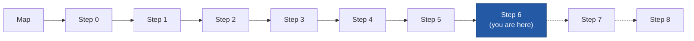
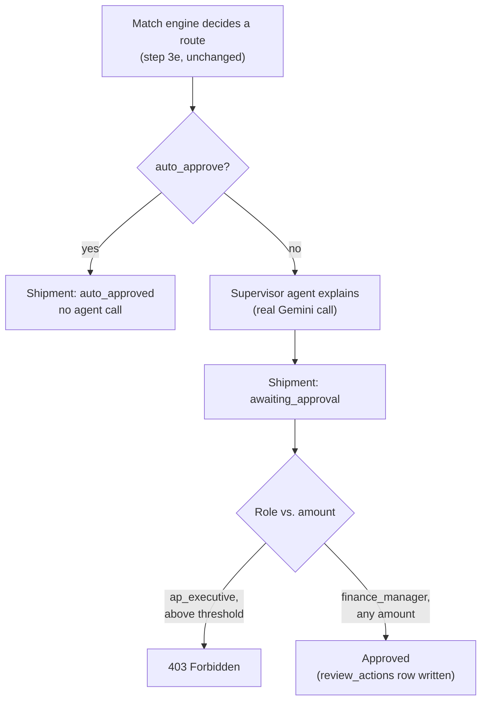

# CrossExam -- Step 6: agents and approval

Step 6 of 8 in the branch-by-branch build. &larr; [Step 5](https://github.com/mayank953/crossexam-project/tree/build/step-5-queue) &middot; [Map](https://github.com/mayank953/crossexam-project/tree/build/map) &middot; Step 7 (coming) &middot; [The finished system (main)](https://github.com/mayank953/crossexam-project/tree/main)

## Why this step exists

[Step 5](https://github.com/mayank953/crossexam-project/tree/build/step-5-queue) decided a route for every shipment (`auto_approve`, `investigate`, ...) with the same plain-code match engine steps 3-5 used. Finding a problem is not deciding what to pay, though -- a clean shipment can go straight through, but a shipment with an issue needs a plain-language explanation and a person with the right authority to say yes or no. This step answers both.

## What this step adds

- **A real agent** (`ladder/step6/supervisor.py`): for any shipment that is not a clean `auto_approve`, a Gemini-backed agent -- built with main's own `app/agents/llm.py` and `app/agents/context.py` -- writes a plain-language finding, using the same `SupervisorDecision` shape (`app/schemas.py`) main's real supervisor agent returns.
- **Code still decides, the agent can only tighten it**: the match engine's own route is never loosened by the agent, only possibly made stricter -- the same rule main's own `app/services/pipeline.py` states ("code has the last word").
- **A real approval gate** (`POST /shipments/{id}/decide`): enforces `settings.manager_approval_threshold_inr` (`app/config.py`, &#8377;500,000) -- an `ap_executive` is refused above it, a `finance_manager` is not. Every decision is written to `review_actions`, the real audit-trail table main uses.
- A bundle's split papers are now written as real split-child `Document` rows for the first time, carried over unchanged from step 5.

## What this step does *not* rebuild

main's real system has five agents (classifier, extractor, reconciler, supervisor, exception resolver), a full safety stack around every one of them (PII masking, prompt-injection guard, per-run cost ledger, a shared rate limit, a confidence gate), and a resumable LangGraph investigation thread that a person can approve hours later from any worker. This step builds the one new idea its name promises -- an agent investigates, and the right person approves -- with one agent and a direct approval route. The deeper machinery is real, and it is `main`'s own, not reinvented here smaller.

## Where this sits



## What happens inside this step



## Requirements

- **Docker Desktop**, running, and a **Gemini key** in `.env` (same key as steps 1-5). The approval route needs no key: it is plain code.
- Ports are shifted again (`5435`, `6381`, `8012`).
- No new Python dependencies: the agent uses the same `langchain`/`langchain-google-genai` already installed for steps 1-3.

## Run it

```bash
make up
make demo
```
A real run gives the same two shipments as before, now with an agent's own words attached:
```json
{"po_number": "PO-40002", "status": "awaiting_approval", "route": "investigate",
 "payable_amount": "678300.00", "debit_note_amount": "21710.85",
 "finding": "SKU-2201: billed ₹3306.77 per carton vs PO price ₹3100.00 (6.67% higher, tolerance 2.0%). Agent: SKU-2201 price mismatch: ... (confidence 1.00)"}
{"po_number": "PO-40010", "status": "auto_approved", "route": "auto_approve", "finding": "No issue found."}
```

### The 403, for real

```bash
curl -X POST "http://localhost:8012/shipments/<id>/decide?decision=approve&actor=priya&role=ap_executive"
# {"detail":"ap_executive may not approve 678,300.00 -- above 500,000.00, this needs a finance_manager."}   HTTP 403

curl -X POST "http://localhost:8012/shipments/<id>/decide?decision=approve&actor=lena&role=finance_manager"
# {"shipment_id":"...","status":"approved"}   HTTP 200
```
The same two calls work from the screen itself: pick a role, press Approve. `make down` stops the stack; `make reset` also deletes the database.

## What it still gets wrong

A refused approval (the 403) is not written anywhere -- only a successful decision reaches `review_actions`, so there is no record of who *tried* and was stopped. And once work is queued across two worker pools, there is still no way to see how much is queued, which worker is doing what, or why a batch is slow. `build/step-7-see-inside` (coming) answers the second; the first is closer to main's own audit design than this step goes.

## Go deeper

The full walkthrough -- the agent's own prompt, the screen's live approve/reject screenshots, and why the agent can tighten but never loosen a route -- is in [`STEP.md`](STEP.md).

Next: `git switch build/step-7-see-inside` (coming)
