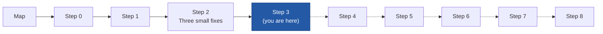
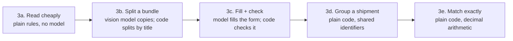

# CrossExam -- Step 3: plain code around the model

Step 3 of 8 in the branch-by-branch build. &larr; [Step 2](https://github.com/mayank953/crossexam-project/tree/build/step-2-three-fixes) &middot; [Map](https://github.com/mayank953/crossexam-project/tree/build/map) &middot; Step 4 &middot; [The finished system (main)](https://github.com/mayank953/crossexam-project/tree/main)

## Why this step exists

[Step 2](https://github.com/mayank953/crossexam-project/tree/build/step-2-three-fixes) still read a three-paper bundle as one paper, wrote one lorry's number two different ways across two papers, and never compared the invoice with the purchase order. Step 3 answers all three -- with **plain code**, calling the model only where nothing else can do the job.

## What this step adds: five small moves

Each move is its own file in [`ladder/step3/`](ladder/step3/) **and its own tag**, so you can check out the repository at exactly that point:

| Move | What it does | Needs the model? | Tag |
|---|---|---|---|
| 3a. Read cheaply | Plain rules pick the cheapest reader for each format (text, spreadsheet, government JSON, or a scan). | No | [`build/step-3a-read-cheaply`](https://github.com/mayank953/crossexam-project/tree/build/step-3a-read-cheaply) |
| 3b. Split a bundle | The vision model copies each scanned page into text; **plain code** then splits the bundle by the title printed on each page. | Yes (to read a scan) | [`build/step-3b-split`](https://github.com/mayank953/crossexam-project/tree/build/step-3b-split) |
| 3c. Fill + check | A model fills the matching form for each paper; **plain code** checks it (a valid tax ID, lines that add up, tax that matches, a total that matches). | Yes (to fill the form) | [`build/step-3c-check`](https://github.com/mayank953/crossexam-project/tree/build/step-3c-check) |
| 3d. Group a shipment | Plain code joins papers that share a strong identifier (a PO number, an e-way bill number, supplier plus invoice number, a batch number) into one shipment. | No | [`build/step-3d-group`](https://github.com/mayank953/crossexam-project/tree/build/step-3d-group) |
| 3e. Match exactly | Plain code compares the shipment's papers against the purchase order in exact decimals, and decides what to pay and what to claw back. | No | [`build/step-3e-match`](https://github.com/mayank953/crossexam-project/tree/build/step-3e-match) |

Only two of the five moves ever call the model. The other three are plain code you can read end to end.

## Where this sits



## What happens inside this step



## Requirements

- **Docker Desktop**, running, and a **Gemini key** in `.env` for moves 3b and 3c.
- Model answers are **cached by file fingerprint** in `data/cache/` (git-ignored), so a second run of 3b or 3c is free and prints the same result. Delete that folder to start fresh.
- 3a, 3d and 3e call no model at all and cost nothing to run, any number of times.

## Run it

```bash
./run.sh ladder/step3/a_read.py          # 3a: no key needed
./run.sh ladder/step3/b_split.py         # 3b: splits the real PO-40002 bundle into 3 papers
./run.sh ladder/step3/c_check.py         # 3c: fills and checks every paper
./run.sh ladder/step3/d_group.py         # 3d: groups 11 papers into 2 shipments
./run.sh ladder/step3/e_match.py         # 3e: the answer
```
A real run of 3e gives the answer the whole step exists to find:
```
PO-40002: route investigate, issues ['PRICE_MISMATCH']
    billed 700,010.85   pay 678,300.00   debit note 21,710.85
PO-40010: route auto_approve, issues none
    billed 92,040.00   pay 92,040.00   debit note 0.00
```
Both match the answer key in `demo-data/ground_truth.json` exactly.

## What it still gets wrong

The answer is right -- but it is a printout, on one laptop. Nobody else can see it, and nobody can approve or reject it. Papers also still arrive one at a time; month end brings thousands. `build/step-4-api-db-screen` answers the first problem; `build/step-5-queue` answers the second.

## Go deeper

The full walkthrough of all five moves, with the real terminal output of each and the doubts people raise, is in [`STEP.md`](STEP.md).
