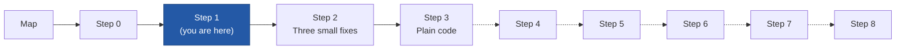
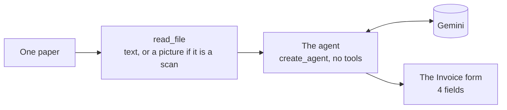

# CrossExam -- Step 1: one agent

Step 1 of 8 in the branch-by-branch build. &larr; [Step 0](https://github.com/mayank953/crossexam-project/tree/build/step-0-start) &middot; [Map](https://github.com/mayank953/crossexam-project/tree/build/map) &middot; [Step 2 &rarr;](https://github.com/mayank953/crossexam-project/tree/build/step-2-three-fixes) &middot; [The finished system (main)](https://github.com/mayank953/crossexam-project/tree/main)

## Why this step exists

Tomás, at Kaveri's Accounts Payable desk, types every invoice in by hand. The simplest thing that could possibly help: give a model one paper and a form, and see what it returns. No queue, no database, no checks, no screen.

## What this step adds

- `ladder/step1_one_agent.py` -- about **65 lines**.
- A four-field **form** (`Invoice`): `supplier_name`, `invoice_number`, `po_number`, `total`. Whatever the model returns must fit this shape.
- One **agent**: a model with no tools, built with LangChain's `create_agent`, that must answer with the form.
- `read_file`: turns a file into text if the PDF has real text, or a picture if it does not.

## Where this sits



## What happens inside this step



## Requirements

- **Docker Desktop**, running.
- **A Gemini key**, in `.env` (`make setup` on [step 0](https://github.com/mayank953/crossexam-project/tree/build/step-0-start) creates the file; paste your key in).
- **About 9 seconds of model time for nine files**, roughly **US$0.003** in total (under a rupee) -- measured on a real run.

## Run it

```bash
./run.sh ladder/step1_one_agent.py demo-data/files/0002_bundle_scan.pdf
```
Or on all nine files of the two shipments this course follows:
```bash
./run.sh ladder/step1_one_agent.py $(ls demo-data/files/0002_* demo-data/files/0010_*)
```
A real run reads the invoice of PO-40002 exactly right:
```
0002_bundle_scan.pdf     supplier_name='Deccan Hygiene Industries' invoice_number='SI/26-27/56132'
po_number='PO-40002' total=700010.85   (2.0 s)
```

## What it gets wrong

The same agent is asked for an **invoice** form on every paper, including an e-way bill and a lorry receipt, which are not invoices. Their fields come back empty or wrong, and nothing is saved -- run it twice and you pay twice. That is exactly what [step 2](https://github.com/mayank953/crossexam-project/tree/build/step-2-three-fixes) fixes, with no new part.

## Go deeper

The full walkthrough -- the real nine-line output, what to notice, the doubts people raise -- is in [`STEP.md`](STEP.md).

Next: `git switch build/step-2-three-fixes`
