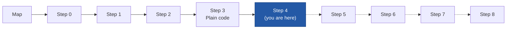
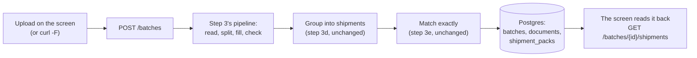

# CrossExam -- Step 4: a shared database, an API and a screen

Step 4 of 8 in the branch-by-branch build. &larr; [Step 3](https://github.com/mayank953/crossexam-project/tree/build/step-3-plain-code) &middot; [Map](https://github.com/mayank953/crossexam-project/tree/build/map) &middot; Step 5 &middot; [The finished system (main)](https://github.com/mayank953/crossexam-project/tree/main)

## Why this step exists

[Step 3](https://github.com/mayank953/crossexam-project/tree/build/step-3-plain-code) got the right answer -- but the answer was a printout, on one laptop. Nobody else could see it, and there was nowhere for the answer to live once the terminal closed. This step answers that with **no new idea about reading papers or matching money** -- it is the exact same five moves from step 3, just placed behind a database, an API and a screen so more than one person can see the result.

## What this step adds

- A **Postgres database** (`app/db/models.py`, `app/db/session.py`, `app/config.py` -- the real files the finished system uses).
- An **API** (`ladder/step4/api.py`): `POST /batches` to upload papers, `GET /batches` and `GET /batches/{id}/shipments` to see what came out.
- A **screen** (`ladder/step4/web.py`, one page, no build step): an upload box, a list of batches, a table of shipments with the route and the money.
- Everything in between -- reading, splitting, filling, checking, grouping, matching -- is **step 3's code, unchanged**, called synchronously instead of printed to a terminal. `ladder/step4/orchestrate.py` is the only new logic, and all it does is call step 3's functions and write the result as rows.

## Where this sits



## What happens inside this step



## Requirements

- **Docker Desktop**, running, and a **Gemini key** in `.env` (same key as steps 1-3).
- This step adds a database, so the stack now runs with `docker compose` instead of `./run.sh`. Ports are shifted (`5433`, `8010`) so it never collides with the finished system's own stack on `main` (`5432`, `8000`, `8080`).
- `ENABLE_PGVECTOR=0`: the one column that would need the Postgres `vector` extension (`Resolution.embedding`, used from step 6 onward) is a plain JSON column here. Nothing in this step is slower or less real for it.
- Every model call is still cached by file fingerprint in `data/cache/` (git-ignored), same as step 3. A second upload of the same papers costs nothing.

## Run it

```bash
make up                                                    # build and start Postgres + the API/screen
make demo                                                   # load PO-40002 and PO-40010 straight into the database
```
Then open **http://localhost:8010** -- the screen shows the batch you just loaded and its shipments, with the same answer step 3 printed to the terminal:
```
PO-40002   investigate       billed 700,010.85   pay 678,300.00   debit note 21,710.85
PO-40010   auto_approve      billed  92,040.00   pay  92,040.00   debit note      0.00
```
You can also upload through the screen itself: drag any files from `demo-data/files/` onto the upload box and watch a new batch and new shipments appear within seconds (`PYTHONPATH` and ports are already set by `docker-compose.yml`).

`make down` stops the stack; `make reset` also deletes the database, if you want to start from an empty one.

## What it still gets wrong

The answer now lives in a database and anyone with the screen's URL can see it -- but nobody can **approve or reject** it, and a big upload simply makes the request wait longer, because everything still runs inside the one API request that received it. Month end brings thousands of papers at once; this step would just make that one request very slow. `build/step-5-queue` answers the second problem with workers that share the work; `build/step-6-agents-approval` answers the first.

## Go deeper

The full walkthrough -- what each new file does, a real `curl` upload, and what the database rows look like -- is in [`STEP.md`](STEP.md).

Next: `git switch build/step-5-queue`
