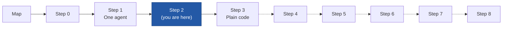
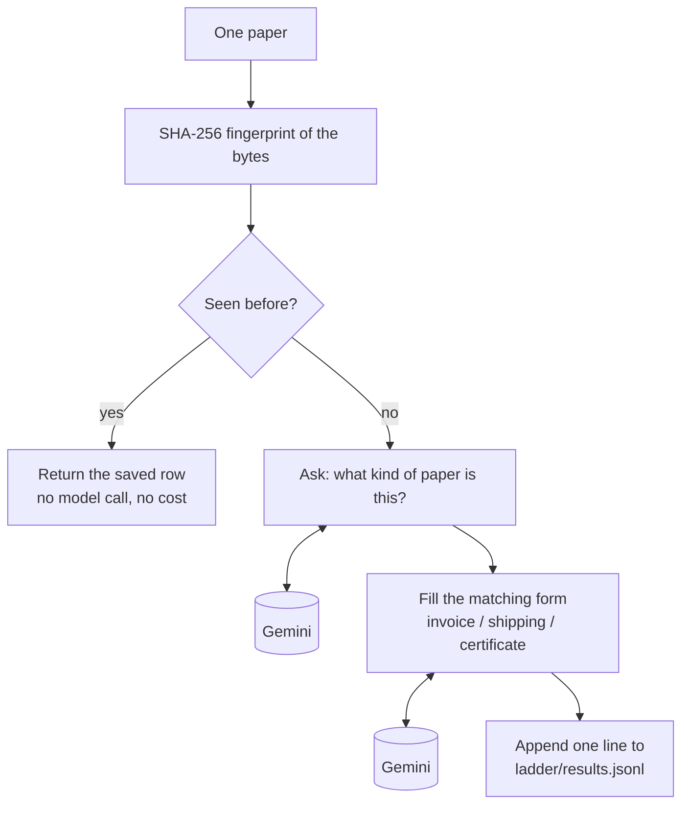

# CrossExam -- Step 2: three small fixes

Step 2 of 8 in the branch-by-branch build. &larr; [Step 1](https://github.com/mayank953/crossexam-project/tree/build/step-1-one-agent) &middot; [Map](https://github.com/mayank953/crossexam-project/tree/build/map) &middot; [Step 3 &rarr;](https://github.com/mayank953/crossexam-project/tree/build/step-3-plain-code) &middot; [The finished system (main)](https://github.com/mayank953/crossexam-project/tree/main)

## Why this step exists

[Step 1](https://github.com/mayank953/crossexam-project/tree/build/step-1-one-agent) got other papers the wrong form, and running it twice did all the work again, at the same cost, with nothing saved. Three small fixes answer this -- **no new part, no new technology**, just a little more code around the same one agent.

## What this step adds

- `ladder/step2_three_small_fixes.py` -- builds directly on step 1's `step1_one_agent.py`.
- **A kind of paper first**: a tiny form (`Kind`) that only says `invoice`, `shipping`, `certificate` or `other`.
- **A form per kind**: each kind gets the fields that actually apply to it (`Shipping` has `vehicle_number`; `Certificate` has `batch_number`, `expiry_date`, `result`).
- **A fingerprint for every file**: SHA-256 of the bytes. A fingerprint seen before is returned from the saved row, with no model call.
- **Saved as it arrives**: one line appended to `ladder/results.jsonl` the moment an answer exists, not at the end of the run.

## Where this sits



## What happens inside this step



## Requirements

- **Docker Desktop**, running, and a **Gemini key** in `.env` (same as step 1).
- **The first run of nine files**: about 17 seconds, two model calls per file. **The second run of the same files**: about 3.5 seconds, every line says `skipped`, no model call at all.

## Run it

```bash
rm -f ladder/results.jsonl
./run.sh ladder/step2_three_small_fixes.py demo-data/files/0002_* demo-data/files/0010_*
./run.sh ladder/step2_three_small_fixes.py demo-data/files/0002_* demo-data/files/0010_*   # again: free
```
A real run shows the fix working, and one thing still wrong:
```
0002_bundle_scan.pdf     other        {}
0010_einvoice.json       invoice      {'supplier_name': 'Tungabhadra Detergents Ltd', ...}
```

## What it still gets wrong

`0002_bundle_scan.pdf` is **three papers in one scanned file** -- an invoice, a packing list, a lorry receipt -- but this step gives it one kind and one form. One lorry is also written two different ways across two papers (`KL19KI5987` and `KL19 KI 5987`), and nothing here compares the invoice's price with the purchase order. [Step 3](https://github.com/mayank953/crossexam-project/tree/build/step-3-plain-code) answers all three with plain code, no new technology.

## Go deeper

The full walkthrough, plus an interactive look at how the fingerprint behaves on a changed file, is in [`STEP.md`](STEP.md).

Next: `git switch build/step-3-plain-code`
