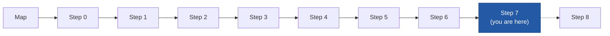
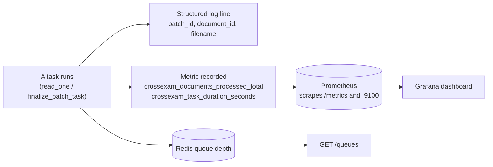

# CrossExam -- Step 7: seeing inside

Step 7 of 8 in the branch-by-branch build. &larr; [Step 6](https://github.com/mayank953/crossexam-project/tree/build/step-6-agents-approval) &middot; [Map](https://github.com/mayank953/crossexam-project/tree/build/map) &middot; Step 8 (coming) &middot; [The finished system (main)](https://github.com/mayank953/crossexam-project/tree/main)

## Why this step exists

Every step since [step 5](https://github.com/mayank953/crossexam-project/tree/build/step-5-queue) has moved work through a queue and, since [step 6](https://github.com/mayank953/crossexam-project/tree/build/step-6-agents-approval), an agent. None of it could be *seen*: no queue depth, no per-task timing, no record of what a worker just did. This step answers the plain question "is it stuck, or just busy?" with real numbers instead of a guess.

## What this step adds

- **Structured logs** (`app/observability/logging.py`, main's own file): every task binds its `batch_id`, `document_id` and `filename` to the logger before it does anything, so one line of JSON tells the whole story of that paper.
- **Real metrics** (`app/observability/metrics.py`, main's own file, main's own instrument names): `crossexam_documents_processed_total`, `crossexam_packs_routed_total`, `crossexam_task_duration_seconds`. The API exposes its own at `/metrics`; each worker exposes its own on port 9100 (that split is main's own design -- see `monitoring/prometheus.yml`'s two separate scrape jobs).
- **`GET /queues`**: the actual number of tasks waiting on each Redis queue, read directly -- the plain fact behind "is it stuck?"
- **Flower**, always on (`http://localhost:5556`): every task's real state, worker and runtime.
- **Prometheus and Grafana**, behind `make monitoring` (main's own compose file gates them the same way, behind `--profile monitoring`) -- the Grafana image alone is about 0.6 GB, so this step does not pull it by default.

## Where this sits



## What happens inside this step



## Requirements

- **Docker Desktop**, running, and a **Gemini key** in `.env` (same key as steps 1-6).
- Ports are shifted again (`5436`, `6382`, `8013`, `5556` for Flower; `9101`/`9102` for the two workers' own metrics).
- `make monitoring` downloads the Prometheus and Grafana images the first time -- roughly 0.6 GB. `make up` alone never touches them.
- LangSmith (trace-level detail inside an agent's own run) needs its own key and was **not run** for this step; `otel_exporter` stays `none`, so no trace backend is contacted at all.

## Run it

```bash
make up
make demo
```
Real output, read straight from the running stack:
```bash
curl http://localhost:8013/queues
# {"reader.urgent":0,"reader.normal":0,"reader.bulk":0,"agent.urgent":0,"agent.normal":0,"agent.bulk":0}

curl http://localhost:9101/ | grep crossexam_documents
# crossexam_documents_processed_total{doc_type="invoice",...,outcome="read"} 2.0
# crossexam_documents_processed_total{doc_type="eway_bill",...,outcome="read"} 2.0
# ... (11 papers from 9 files: the bundle scan alone splits into 3)

curl http://localhost:9102/ | grep crossexam_packs_routed
# crossexam_packs_routed_total{...,route="investigate"} 1.0
# crossexam_packs_routed_total{...,route="auto_approve"} 1.0
```
Open **http://localhost:5556** (Flower) for the real task history -- every `read_one` and `finalize_batch_task`, which worker ran it, and how long it took. `make monitoring` then opens Prometheus at `:9091` and Grafana at `:3001`.

## What it still gets wrong

A refused approval from step 6 still writes nothing anywhere, queue depth and metrics are not yet wired to alert anyone, and this step's own dashboard is the stock one copied from `main` -- nobody has looked at it with a real month-end backlog behind it. And everything so far still runs on one laptop. `build/step-8-cloud` (coming) is where that changes -- or rather, where main's own files for it are validated, since nothing in step 8 actually reaches a cloud project.

## Go deeper

The full walkthrough -- the real metric names, a Flower screenshot, and why worker metrics and API metrics are two separate endpoints -- is in [`STEP.md`](STEP.md).

Next: `git switch build/step-8-cloud` (coming)
