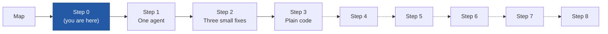
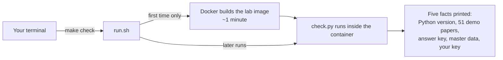

# CrossExam -- Step 0: get it running

Step 0 of 8 in the branch-by-branch build. &larr; [Map](https://github.com/mayank953/crossexam-project/tree/build/map) &middot; [Step 1 &rarr;](https://github.com/mayank953/crossexam-project/tree/build/step-1-one-agent) &middot; [The finished system (main)](https://github.com/mayank953/crossexam-project/tree/main)

## Why this step exists

You cannot build on what you cannot run. Before any agent, any form, any check, there has to be one command that proves Docker works, the demo papers are there, and (once you have one) your key is set. Nothing here calls a model — step 0 costs nothing to run.

## What this step adds

- A small **Docker image** (`Dockerfile`, `requirements-lab.txt`): Python and the few libraries steps 1 to 3 need.
- `run.sh`: runs any Python file of this repository inside that image, with the project folder mounted — edit a file, run it again, no rebuild.
- `check.py` and `make check`: five plain facts, printed in a few seconds.
- `make setup`: creates `.env` from the template (never overwrites one that already exists).

## Where this sits



## What happens inside this step



## Requirements

- **Docker Desktop**, running.
- **About a minute**, the first time, while the image builds. Every run after that starts at once.
- **No key needed for this step.** `make check` reports whether one is set, because step 1 is the first that needs it.

## Run it

```bash
make setup      # creates .env; put your Gemini key in it (not needed until step 1)
make check
```

A real run of this branch prints:
```
Python           3.12.16 (inside the lab image)
Demo papers      51 files in demo-data/files
Answer key       found
Master data      found
Gemini key       set
Libraries        langchain 1.4.6, pypdf 6.21.1
```

## Where the files are

| Path | What it is |
|---|---|
| `demo-data/files/` | the 51 invented papers of Kaveri Distributors (the same files in every step) |
| `demo-data/master.json` | the purchase orders and goods receipts the papers are checked against |
| `demo-data/ground_truth.json` | the answer key |
| `run.sh` | runs a Python file inside the lab image |
| `.env` | your key, created by `make setup`, never committed |

## Go deeper

The full walkthrough — what to notice, questions people ask — is in [`STEP.md`](STEP.md).

Next: `git switch build/step-1-one-agent`
