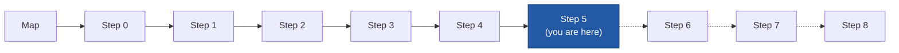
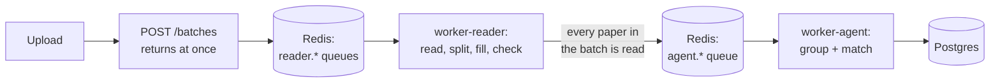

# CrossExam -- Step 5: a queue

Step 5 of 8 in the branch-by-branch build. &larr; [Step 4](https://github.com/mayank953/crossexam-project/tree/build/step-4-api-db-screen) &middot; [Map](https://github.com/mayank953/crossexam-project/tree/build/map) &middot; Step 6 (coming) &middot; [The finished system (main)](https://github.com/mayank953/crossexam-project/tree/main)

## Why this step exists

[Step 4](https://github.com/mayank953/crossexam-project/tree/build/step-4-api-db-screen) put the answer in a database anyone could query -- but every paper was still read inside the one HTTP request that uploaded it. Nine papers took a few seconds; a month-end batch of thousands would make that one request wait minutes, and a restart mid-upload would lose whatever had not been written yet. This step answers both: the upload request now returns at once, and two worker pools read and match the papers in the background, picking the work back up if one of them dies partway through.

## What this step adds

- **Redis**, as the message broker between the API and the workers.
- **Two worker pools** (`ladder/step5/tasks.py`): `worker-reader` reads, splits, fills and checks a paper (step 3a/b/c); `worker-agent` groups a batch into shipments and matches each one (step 3d/3e) once every paper in the batch is read. The split mirrors main's own real queue names (`reader.*` / `agent.*`).
- **`ladder/step5/celery_app.py`**: the same queue names, priorities and resilience settings (`task_acks_late`, `task_reject_on_worker_lost`, one task per worker at a time) as main's real `app/workers/celery_app.py` -- see that file's own docstring for why this step keeps its own copy rather than importing main's directly.
- A bundle scan still splits into several papers from one file (step 3b). main's own schema already has a rule for this -- a Document row becomes the *parent* of one child Document per paper found inside it -- and this step uses that rule for real, for the first time.

## Where this sits



## What happens inside this step



## Requirements

- **Docker Desktop**, running, and a **Gemini key** in `.env` (same key as steps 1-4).
- Ports are shifted again (`5434`, `6380`, `8011`) so this step, step 4 and the finished system on `main` can all exist on this machine without touching each other's database, broker or port.
- The broker's **visibility timeout** (how long an unacked message waits before a worker that died is assumed lost and its task is redelivered) is set to **20 seconds** for this step's demo, not main's own 3600 -- so a killed worker's recovery is visible within a recording, not within the next hour.

## Run it

```bash
make up      # build and start Postgres, Redis, the API/screen and two worker pools
make demo    # upload PO-40002 and PO-40010 through the real API
```
A real run:
```
batch eccae13c-...: 9 file(s) queued, 0 already seen.
The request returned immediately -- nothing has been read yet. Watching for the workers to finish...
grouped after the workers finished.
```
The whole round trip -- queue, read, split, fill, check, group, match -- took **3.7 seconds**, measured end to end. `curl http://localhost:8011/batches/<id>/shipments` gives the same two numbers steps 3 and 4 did: `PO-40002` pay 678,300.00, debit note 21,710.85; `PO-40010` pay 92,040.00, no issue.

### Kill a worker mid-batch

```bash
make kill-reader   # SIGKILL worker-reader, then start it again
```
A real run, on a 42-paper upload: the reader worker was killed at `23:17:58`, restarted at `23:18:03` (5 seconds later), and the batch was `grouped` by `23:18:10` -- 12 seconds after the kill, under the 20-second visibility timeout this demo uses. The in-flight papers the killed worker had not finished were redelivered and read again by the worker once it came back; nothing was lost.

`make down` stops the stack; `make reset` also deletes the database and the queue.

## What it still gets wrong

A paper is still either auto-approved or sent to `needs_review` by the same plain-code match engine step 3 and 4 used -- nothing **decides** what to do about a problem, and nothing routes it to the right person. And once work is queued, there is still no way to see *how much* is queued, which worker is doing what, or why a batch is slow. `build/step-6-agents-approval` (coming) answers the first; `build/step-7-see-inside` (coming) answers the second.

## Go deeper

The full walkthrough -- the real task code, both worker logs, and the worker-kill timing above -- is in [`STEP.md`](STEP.md).

Next: `git switch build/step-6-agents-approval` (coming)
