# CrossExam, one step at a time

The same system taught in the course, built up in small, honest steps. Every step is a **branch** you can check out and run on its own. Each branch adds one idea to the branch before it, and only because the step before it showed a real problem that idea answers.

**The use case, all the way through.** Kaveri Distributors receives a shipment as a pile of papers: scans, PDFs, photos, spreadsheets, government files. The software must turn them into one decision: *is the supplier asking for the right amount, and what do we pay?* The papers, the purchase orders and the right answer key are in [`demo-data/`](demo-data/) and are invented.

## The complete, finished system lives on `main`

This branch, and every `build/*` branch, is a **teaching copy**: a small, growing slice of the real project, built one honest step at a time, for recording and following along. It is never the thing to build a real system on.

The full, working CrossExam — the FastAPI service, the Celery workers, the agents, the React screen, the Terraform — lives on **[`main`](https://github.com/mayank953/crossexam-project/tree/main)**, in the same clone, the same folder. If you only want the finished app, `git switch main` and read the [top-level README](https://github.com/mayank953/crossexam-project/blob/main/README.md) instead of this one.

## Where this sits

```mermaid
graph LR
    MAP["Map<br/>(you are here)"] --> S0["Step 0<br/>Get it running"]
    S0 --> S1["Step 1<br/>One agent"]
    S1 --> S2["Step 2<br/>Three small fixes"]
    S2 --> S3["Step 3<br/>Plain code around the model"]
    S3 --> S4["Step 4<br/>API, database, screen"]
    S4 --> S5["Step 5<br/>Queue"]
    S5 --> S6["Step 6<br/>Agents + approval"]
    S6 --> S7["Step 7<br/>Seeing inside"]
    S7 --> S8["Step 8<br/>Cloud (validated, not run)"]
    S3 --> MAIN(["main<br/>the finished system"])
    S8 --> MAIN
    style MAP fill:#2459A6,stroke:#173F78,color:#fff
    style MAIN fill:#0F1B2D,stroke:#0F1B2D,color:#fff
```


Every step, 0 through 8, is a real branch you can check out today. Step 8 is the one exception worth naming here too: its code is real and validated, but nothing in it was ever run against an actual cloud project (see its own `README.md`).

## Start here
```bash
git clone https://github.com/mayank953/crossexam-project.git
cd crossexam-project
git switch build/step-0-start       # the setup
make setup                          # creates .env: put your Gemini key in it (every step from 1 onward calls a model)
make check                          # proves Docker, the papers and (optionally) the key work
```
Then move one step at a time: `git switch build/step-1-one-agent`, read that branch's `README.md` and `STEP.md`, run what it says.
To see exactly what one step added over the step before it: `git diff build/step-1-one-agent..build/step-2-three-fixes --stat`.
To go back to the full project at any point: `git switch main`.

## The steps

| Branch | Why it exists (the problem the step before left open) | What it adds | Needs a key? | Status |
|---|---|---|---|---|
| [`build/step-0-start`](https://github.com/mayank953/crossexam-project/tree/build/step-0-start) | You cannot build on what you cannot run. | A Docker image, `run.sh`, `make check`. | No | **built** |
| [`build/step-1-one-agent`](https://github.com/mayank953/crossexam-project/tree/build/step-1-one-agent) | Tomás types every invoice by hand. | One LangChain agent reads one paper and fills in a form. | Yes | **built** |
| [`build/step-2-three-fixes`](https://github.com/mayank953/crossexam-project/tree/build/step-2-three-fixes) | Other papers get the wrong form, and a repeat does all the work again. | A kind of paper, a fingerprint, saved results. No new part. | Yes | **built** |
| [`build/step-3-plain-code`](https://github.com/mayank953/crossexam-project/tree/build/step-3-plain-code) | A bundle holds several papers, and nothing compares the invoice with the order. | Plain code around the model: read cheaply, split a bundle, check a form, group a shipment, match exactly. | Yes (only for two of its five moves) | **built** |
| [`build/step-4-api-db-screen`](https://github.com/mayank953/crossexam-project/tree/build/step-4-api-db-screen) | The answer is a printout on one laptop; nobody else can see or decide. | A Postgres database, a FastAPI service, a one-page screen. | Yes | **built** |
| [`build/step-5-queue`](https://github.com/mayank953/crossexam-project/tree/build/step-5-queue) | Month end brings thousands of papers; one worker can die mid-batch. | Celery and Redis, two worker pools. | Yes | **built** |
| [`build/step-6-agents-approval`](https://github.com/mayank953/crossexam-project/tree/build/step-6-agents-approval) | Finding a problem is not deciding what to pay. | A real agent's finding, role-gated approval. | Yes | **built** |
| [`build/step-7-see-inside`](https://github.com/mayank953/crossexam-project/tree/build/step-7-see-inside) | When it looks stuck, nobody can say why. | Structured logs, real metrics, Flower; Prometheus/Grafana opt in. | Yes | **built** |
| [`build/step-8-cloud`](https://github.com/mayank953/crossexam-project/tree/build/step-8-cloud) | It runs on one laptop. | Terraform and Kubernetes, validated offline. | No | **built, not run against a cloud project** |

Smaller moves inside step 3 are **tags**, each one a single, runnable move: `build/step-3a-read-cheaply`, `build/step-3b-split`, `build/step-3c-check`, `build/step-3d-group`, `build/step-3e-match`. Check one out with `git checkout build/step-3c-check` (a tag, not a branch, so it leaves you with a detached `HEAD` — that is expected; `git switch build/step-3-plain-code` returns you to the branch).

## Requirements

- **Docker Desktop**, running. Nothing else is installed on your machine; every step builds and runs inside a container.
- **About a minute** the first time you run `make check` on a new branch, while the image builds. Every run after that starts at once.
- **A Gemini API key**, only from step 1 onward, pasted into `.env` (created by `make setup`, and git-ignored — it is never committed). Steps 1 to 7 together cost a fraction of a rupee to run once; model answers are cached by file fingerprint, so running a step again costs nothing.
- **No cloud account, no billing, no internet access beyond the model call.** Everything else runs entirely on your machine.

## Rules we keep

- Your key lives only in `.env`, which git ignores. Never paste it into a file that gets committed.
- Nothing here calls the cloud. Every step runs on your machine, in Docker.
- Every number printed in a `STEP.md` came from a real run of that branch, on the real demo papers in `demo-data/`. If a number ever looks off, run the command yourself — that is the point of a branch you can check out.
